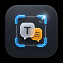

<p align="center">
  
</p>

<h1 align="center">TransFrame</h1>

<p align="center">
  macOS menu bar app for screenshot translation with OCR, multi-engine translation, text selection translation, and translate-and-insert features
</p>

<p align="center">
  <a href="https://github.com/hubo1989/TransFrame/releases"></a>
  <a href="LICENSE"></a>
  <a href="https://www.apple.com/macos/"></a>
  <a href="https://swift.org/"></a>
</p>

<p align="center">
  <a href="README_CN.md">简体中文</a>
</p>

## ✨ Features

### Screenshot Capture
- **Region Capture** - Select any area of the screen to capture
- **Full Screen Capture** - Capture the entire screen with one click
- **Translation Mode** - Translate directly after capture, no extra steps needed
- **Multi-Monitor Support** - Automatic detection and support for multiple displays
- **Retina Display Optimized** - Perfect support for high-resolution displays

### Text Translation
- **Text Selection Translation** - Select any text and translate with a popup result window
- **Translate and Insert** - Safely replace selected text with the translation (target revalidation + paste fallback, no input-method conflicts)
- **Independent Language Settings** - Separate target language configuration for translate-and-insert

### OCR Text Recognition
- **Apple Vision** - Native OCR, no additional configuration required
- **PaddleOCR** - Optional external engine with better Chinese recognition

### Multi-Engine Translation
Two converged modes: **ordered fallback chain** (up to 5 engines, tried in order until one succeeds — a failing engine automatically falls through to the next) and **parallel compare** (2–4 engines translate simultaneously; switch between per-engine results with latency, no re-translation).
- **Apple Translation** - Built-in system translation, works offline (requires macOS 26; on older systems the chain automatically uses your next engine)
- **MTranServer** - Self-hosted translation server for high-quality translation
- **OpenAI-compatible** - One card for OpenAI official / Ollama local / custom endpoints (keyless local endpoints supported)
- **Claude / Gemini / Google / DeepL / Baidu** - Cloud translation APIs
- **Real availability probing** - Status dots reflect actual engine reachability (green/red/orange/gray), never consuming paid API quota on automatic checks
- **Lossless migration** - Upgrading from the old four-mode configuration keeps your engines, keys, and selections

### Annotation Tools
- Rectangle, ellipse, line, arrow, freehand, and text annotations
- **Smart Mosaic / Privacy Redaction** - One-click redaction of detected sensitive regions
- **In-place Results Drawer** - OCR text and bilingual results docked inside the preview window
- Screenshot cropping, undo/redo, ⌘-drag constraints, draggable text

### Other Features
- **Translation History** - Save translation records with search and export
- **Bilingual Display** - Original and translation side by side, grouped by visual line
- **Overlay Display** - Translation results rendered directly on the screenshot
- **Auto Update** - Built-in Sparkle updater (appcast channel)
- **Custom Shortcuts** - Global hotkeys for quick capture and translation
- **Menu Bar Quick Access** - All features accessible from the menu bar
- **Multi-Language UI** - Interface localized in 10 languages; follows the system language

## ⌨️ Keyboard Shortcuts

| Shortcut | Action |
|----------|--------|
| `Cmd+Shift+3` | Capture Full Screen |
| `Cmd+Shift+4` | Capture Selection (default) |
| `Cmd+Shift+T` | Translation Mode (translate after capture) |
| `Cmd+Shift+Y` | Text Selection Translation |
| `Cmd+Shift+I` | Translate and Insert |

> All shortcuts can be customized in Settings

## Preview Window Shortcuts

| Shortcut | Action |
|----------|--------|
| `Enter` / `Cmd+S` | Save Screenshot |
| `Cmd+C` | Copy to Clipboard |
| `Escape` | Close Window / Cancel Crop |
| `R` / `1` | Rectangle Tool |
| `D` / `2` | Freehand Tool |
| `A` / `3` | Arrow Tool |
| `T` / `4` | Text Tool |
| `C` | Crop Mode |
| `Cmd+Z` | Undo |
| `Cmd+Shift+Z` | Redo |

## 📦 Requirements

- macOS 15.0 (Sequoia) or later
- Universal binary: runs natively on Apple Silicon and Intel Macs
- Screen Recording permission (prompted on first use)
- Accessibility permission (required for text translation features)

## Download & Installation

Download the latest `TransFrame-<version>.dmg` from the [Releases](../../releases) page and drag TransFrame to Applications.

> ✅ The app is signed with a Developer ID certificate, notarized, and stapled — it opens on first launch without Gatekeeper workarounds. Updates are delivered in-app via Sparkle.

## 🔧 Tech Stack

- **Swift 6.0** - Modern Swift language features with strict concurrency checking
- **SwiftUI + AppKit** - Declarative UI combined with native macOS components
- **ScreenCaptureKit** - System-level screen recording and capture
- **Vision** - Apple native OCR text recognition
- **Translation** - Apple system translation framework
- **Sparkle 2** - Signed, notarized auto-updates
- **CoreGraphics** - Image processing and rendering

## 📁 Project Structure

```text
TransFrame/
├── App/                    # App entry point and coordinators
│   ├── AppDelegate.swift
│   └── Coordinators/       # Feature coordinators
│       ├── CaptureCoordinator.swift
│       ├── TextTranslationCoordinator.swift
│       └── HotkeyCoordinator.swift
├── Features/               # Feature modules
│   ├── Capture/           # Screenshot capture
│   ├── Preview/           # Preview, annotation & results panel
│   ├── TextTranslation/   # Text selection translation & insertion
│   ├── TranslationFlow/   # Translation pipelines
│   ├── Settings/          # Settings UI (engine cards, chain & compare editors)
│   └── MenuBar/           # Menu bar integration
├── Services/               # Business logic
│   ├── Translation/       # Engine registry, providers, ordered/compare dispatch
│   ├── Pipelines/         # Analysis / translation / render pipelines
│   ├── EngineHealthChecker.swift  # Real availability probing
│   └── ...                 # Keychain, hotkeys, text insertion, etc.
├── Models/                 # Data models (settings, engine selection V2, results)
├── Resources/              # Assets and 10-language localizations
└── TransFrameTests/        # XCTest suite incl. PRD acceptance tests
```

## 🤝 Contributing

Contributions are welcome! Please read [CONTRIBUTING.md](CONTRIBUTING.md) for guidelines.

## 📄 License

This project is licensed under the MIT License - see the [LICENSE](LICENSE) file for details.
