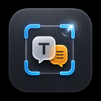

<p align="center">
  
</p>

<h1 align="center">TransFrame</h1>

<p align="center">
  macOS 菜单栏截图翻译工具，支持 OCR 识别、多引擎翻译、文本选择翻译和翻译插入
</p>

<p align="center">
  <a href="https://github.com/hubo1989/TransFrame/releases"></a>
  <a href="LICENSE"></a>
  <a href="https://www.apple.com/macos/"></a>
  <a href="https://swift.org/"></a>
</p>

<p align="center">
  <a href="README.md">English</a>
</p>

## ✨ 功能特性

### 截图功能
- **区域截图** - 选择屏幕任意区域进行截图
- **全屏截图** - 一键截取整个屏幕
- **翻译模式** - 截图后直接翻译，无需额外操作
- **多显示器支持** - 自动识别并支持多显示器环境
- **Retina 屏幕优化** - 完美支持高分辨率显示器

### 文本翻译
- **文本选择翻译** - 选中任意文本，一键翻译并弹出结果窗口
- **翻译并插入** - 目标复核 + 粘贴兜底，安全地将选中文本替换为译文（绕过输入法）
- **独立语言设置** - 翻译并插入支持独立的目标语言配置

### OCR 文字识别
- **Apple Vision** - 原生 OCR，无需额外配置
- **PaddleOCR** - 可选外部引擎，中文识别更准确

### 多引擎翻译
两种收敛模式：**顺序退避**（最多 5 个引擎按序尝试，某引擎失败自动降级到下一个）与**并行对比**（2–4 个引擎同时翻译，按引擎切换查看结果与延迟，切换不重新翻译）。
- **Apple 翻译** - 系统内置，离线可用（需 macOS 26；旧系统上自动使用链中下一个引擎）
- **MTranServer** - 自建翻译服务器，高质量翻译
- **OpenAI 兼容** - 一张卡片覆盖 OpenAI 官方 / Ollama 本地 / 自定义端点（支持无密钥本地端点）
- **Claude / Gemini / Google / DeepL / 百度** - 云翻译 API
- **真实可用性探测** - 状态点反映引擎实际可达性（绿/红/橙/灰四态），自动检查绝不消耗付费 API 配额
- **无损迁移** - 从旧版四模式配置升级，引擎、密钥与选择全部保留

### 标注工具
- 矩形、椭圆、直线、箭头、手绘、文字标注
- **智能马赛克 / 隐私擦除** - 一键擦除自动识别的敏感区域
- **内嵌结果面板** - OCR 文本与双语对照结果停靠在预览窗口内
- 截图裁剪、撤销重做、⌘ 拖拽约束、文字提交后可拖动

### 其他功能
- **翻译历史** - 保存翻译记录，支持搜索和导出
- **双语对照** - 原文译文并排显示，按视觉行分组
- **覆盖层显示** - 翻译结果直接渲染在截图上方
- **自动更新** - 内置 Sparkle 更新通道
- **自定义快捷键** - 支持全局快捷键快速截图和翻译
- **菜单栏快捷操作** - 所有功能均可通过菜单栏访问
- **多语言界面** - 界面本地化 10 种语言，默认跟随系统语言

## ⌨️ 快捷键

| 快捷键 | 功能 |
|----------|--------|
| `Cmd+Shift+3` | 全屏截图 |
| `Cmd+Shift+4` | 区域截图（默认） |
| `Cmd+Shift+T` | 翻译模式（截图后直接翻译） |
| `Cmd+Shift+Y` | 文本选择翻译 |
| `Cmd+Shift+I` | 翻译并插入 |

> 所有快捷键均可在设置中自定义

## 预览窗口快捷键

| 快捷键 | 功能 |
|----------|--------|
| `Enter` / `Cmd+S` | 保存截图 |
| `Cmd+C` | 复制到剪贴板 |
| `Escape` | 关闭窗口 / 取消裁剪 |
| `R` / `1` | 矩形工具 |
| `D` / `2` | 手绘工具 |
| `A` / `3` | 箭头工具 |
| `T` / `4` | 文字工具 |
| `C` | 裁剪模式 |
| `Cmd+Z` | 撤销 |
| `Cmd+Shift+Z` | 重做 |

## 📦 安装要求

- macOS 15.0 (Sequoia) 或更高版本
- Universal 双架构二进制：Apple Silicon 与 Intel Mac 均可原生运行
- 屏幕录制权限（首次使用时会提示）
- 辅助功能权限（文本翻译功能需要）

## 下载安装

从 [Releases](../../releases) 页面下载最新的 `TransFrame-<version>.dmg`，将 TransFrame 拖入「应用程序」即可。

> ✅ 应用已使用 Developer ID 证书签名、公证并 staple——首次打开无需任何 Gatekeeper 绕过操作。更新通过内置 Sparkle 自动送达。

## 🔧 技术栈

- **Swift 6.0** - 现代 Swift 语言特性，严格并发检查
- **SwiftUI + AppKit** - 声明式 UI 与原生 macOS 组件结合
- **ScreenCaptureKit** - 系统级屏幕录制与截图
- **Vision** - Apple 原生 OCR 文字识别
- **Translation** - Apple 系统翻译框架
- **Sparkle 2** - 签名公证的自动更新
- **CoreGraphics** - 图像处理与渲染

## 📁 项目结构

```text
TransFrame/
├── App/                    # 应用入口与协调器
│   ├── AppDelegate.swift
│   └── Coordinators/       # 功能协调器
│       ├── CaptureCoordinator.swift
│       ├── TextTranslationCoordinator.swift
│       └── HotkeyCoordinator.swift
├── Features/               # 功能模块
│   ├── Capture/           # 截图捕获
│   ├── Preview/           # 预览、标注与结果面板
│   ├── TextTranslation/   # 文本选择翻译与插入
│   ├── TranslationFlow/   # 翻译管线
│   ├── Settings/          # 设置界面（引擎卡片、链与对比编辑器）
│   └── MenuBar/           # 菜单栏集成
├── Services/               # 业务逻辑
│   ├── Translation/       # 引擎注册表、Provider、顺序/对比分发
│   ├── Pipelines/         # 分析 / 翻译 / 渲染管线
│   ├── EngineHealthChecker.swift  # 真实可用性探测
│   └── ...                 # 钥匙串、快捷键、文本插入等
├── Models/                 # 数据模型（设置、引擎选择 V2、结果）
├── Resources/              # 资源与 10 语言本地化
└── TransFrameTests/        # XCTest 测试套件（含 PRD 验收测试）
```

## 🤝 贡献指南

欢迎贡献！请先阅读 [CONTRIBUTING.md](CONTRIBUTING.md)。

## 📄 许可证

本项目基于 MIT 许可证开源，详见 [LICENSE](LICENSE) 文件。
