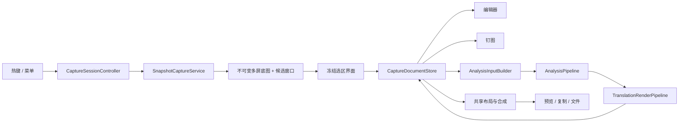

# TransFrame 截图、标注、钉图、识别与翻译完整升级规划

日期：2026-10-21 ｜ 状态：规划建议，尚未实施 ｜ 代码基线：`hubo/draw`，`4b153a1`

## 一页速览

**推荐先做“冻结取景 + 文档状态一致”，再增强操作能力。** 当前问题横跨截图时机、坐标、编辑状态与异步任务；只扩充工具按钮，会把这些问题带进钉图、识别和翻译。

1. **截图立即冻结**：收到截图快捷键后先采集静态底图，再显示选区界面；后续选窗口、框选、放大、调整、确认，始终读取同一份像素。
2. **窗口识别更可靠**：在冻结时保存窗口候选，支持原地单击、候选切换、浮层策略和精确选区；不再追踪冻结画面背后继续变化的窗口。
3. **截图变成可编辑文档**：原始图、裁切、标注、识别和翻译有明确版本；预览与钉图共享文档，解决裁切丢标注、识别结果过期、重复钉图不更新。
4. **标注形成完整编辑能力**：补齐撤销事务、形状缩放、箭头端点、多行文字重编辑、视口缩放与预览/导出一致性，保留已有 9 类工具。
5. **钉图可继续工作**：增加缩放、复制、保存、返回编辑、区域识别和翻译；透明度、锁位置、穿透、隐藏与找回具有明确退出入口。
6. **二次识别与重新翻译分开**：支持全图、局部、选中文字块重识别；换语言或翻译引擎可直接重译，改原文只使对应译文失效。
7. **结果真实可追踪**：展示实际引擎、输入范围、版本、失败与降级；取消不再触发备用请求，旧任务不能覆盖新文档。
8. **分 7 个里程碑交付**：M0 基线 → M1 冻结 → M2 文档 → M3 选择 → M4 编辑/钉图 → M5 识别/翻译 → M6 实机验收。M3、M4、M5 在 M2 后可拆责任并行。

**“彻底冻结”的工程边界**：固定用户操作时看到的截图画面；视频、网页和其他进程仍在后台运行。一次性异步截图不能承诺物理按键瞬间零延迟，也不能保证多屏硬件级同一帧。本规划要求所有后续操作与已经冻结的底图严格一致，并测量触发到冻结的延迟。持续后台采屏不作为默认实现。

本次只新增规划文档，未修改业务源码、用户设置或凭证，未提交或发布。已完成当前代码和测试目标的编译检查；桌面交互、截图权限、多屏和真实模型效果尚未运行验收。

## 1. 当前代码事实与需要优先处理的问题

以下行号均对应上述代码基线。文档和旧设计仅作背景，当前实现以源码为准。

| 范围 | 当前已有能力 | 已确认缺口或静态风险 | 源码证据 |
|---|---|---|---|
| 区域截图 | 多屏 Overlay、拖拽圈选、窗口高亮 | 先展示透明层，完成选择后才调用截图；没有冻结像素 | [CaptureCoordinator.swift](../../TransFrame/App/Coordinators/CaptureCoordinator.swift#L125)、[选区回调](../../TransFrame/App/Coordinators/CaptureCoordinator.swift#L193)、[透明 Overlay](../../TransFrame/Features/Capture/SelectionOverlayWindow.swift#L62) |
| 全屏截图 | 可选择显示器 | 多屏时先等显示器菜单，再采集；同样不是触发时冻结 | [CaptureCoordinator.swift](../../TransFrame/App/Coordinators/CaptureCoordinator.swift#L74) |
| 窗口识别 | CGWindowList、Z-order、100ms 缓存、鼠标悬停命中 | 只保留 layer 0，按应用名排除自身；原地直接点选、晚到高亮存在问题路径 | [WindowDetector.swift](../../TransFrame/Services/WindowDetector.swift#L107)、[过滤](../../TransFrame/Services/WindowDetector.swift#L188)、[异步高亮](../../TransFrame/Features/Capture/SelectionOverlayWindow.swift#L630) |
| 窗口截图语义 | 选中窗口的屏幕矩形 | 输出未传 windowID，本质是可见屏幕区域，不能宣称获取被遮挡的完整窗口 | [SelectionOverlayWindow.swift](../../TransFrame/Features/Capture/SelectionOverlayWindow.swift#L564) |
| 多屏坐标 | 显示器匹配、scale、单屏区域裁取 | 使用当前屏高度翻转全局坐标，异高/上下屏存在错误路径；每屏独立选区，未实现跨屏拼接 | [坐标转换](../../TransFrame/Features/Capture/SelectionOverlayWindow.swift#L523)、[区域裁取](../../TransFrame/Features/Capture/CaptureManager.swift#L289) |
| 标注 | 矩形、椭圆、直线、箭头、手绘、高亮、马赛克、文字、编号；选择、移动、样式修改 | 选择手柄只有绘制；无实际 resize/端点调整，文字不能重新编辑内容，命中仅包围盒 | [Annotation.swift](../../TransFrame/Models/Annotation.swift#L6)、[命中](../../TransFrame/Features/Preview/PreviewViewModel+Drawing.swift#L181)、[手柄](../../TransFrame/Features/Preview/AnnotationCanvas.swift#L496) |
| 撤销/裁切 | 15 级 Screenshot 快照撤销；像素裁切 | 拖动没有写入撤销；裁切重建 Screenshot，丢原标注/id/格式等状态，未处理旧 OCR | [拖动结束](../../TransFrame/Features/Preview/PreviewViewModel+Drawing.swift#L343)、[裁切](../../TransFrame/Features/Preview/PreviewViewModel+Crop.swift#L37) |
| 预览/导出 | 保存/复制、PNG/JPEG/HEIC、标注合成 | 显示与导出两套 renderer；文字分别使用 SwiftUI Text 与 CTLine，多行/字形一致性缺验证 | [Canvas 文本](../../TransFrame/Features/Preview/AnnotationCanvas.swift#L277)、[导出文本](../../TransFrame/Services/ImageExporter+AnnotationRendering.swift#L145) |
| 钉图 | 置顶、跨 Space、拖动、悬停关闭，最多 5 张 | 不可变图片副本，无 OCR/翻译/编辑；同 id 再钉只唤起旧窗，不更新编辑后的内容 | [PinnedWindow.swift](../../TransFrame/Features/Pinned/PinnedWindow.swift#L9)、[PinnedWindowsManager.swift](../../TransFrame/Features/Pinned/PinnedWindowsManager.swift#L32) |
| 预览 OCR | 对当前 screenshot.image 重新调用 OCR，可复制全文 | 固定英/简中；无 ROI、版本、任务句柄；忽略标注，遮挡后仍会识别底层原图 | [PreviewViewModel+OCR.swift](../../TransFrame/Features/Preview/PreviewViewModel+OCR.swift#L6) |
| OCR 入口一致性 | Vision/Paddle 与截图分析 VLM 均已存在 | Preview 的 Paddle 默认配置与截图翻译的 PaddleOCRVLM 配置不同，不能视为相同策略 | [OCREngineProtocol.swift](../../TransFrame/Services/OCREngineProtocol.swift#L32)、[PaddleOCRVLMProvider.swift](../../TransFrame/Services/PaddleOCRVLMProvider.swift#L76) |
| 识别内容过滤 | 已有噪声/prompt leakage 启发式 | 纯数字、边缘日期或包含 boundingBox/置信度等真实技术文字可能被误滤；应保留原始结果及过滤原因 | [ScreenAnalysisResult.swift](../../TransFrame/Models/ScreenAnalysisResult.swift#L61) |
| 图片翻译 | 分析→过滤→翻译→渲染，已有多引擎、fallback/parallel/场景配置 | 图片路径丢失 bundle 的实际引擎/失败信息；预览与钉图未接入同一条工作流 | [TranslationRenderPipeline.swift](../../TransFrame/Services/Pipelines/TranslationRenderPipeline.swift#L24)、[PreviewResultsPanel.swift](../../TransFrame/Features/Preview/PreviewResultsPanel.swift#L30) |
| 异步与取消 | TranslationFlowController 有单一 currentTask | 无结果归属版本校验；旧任务取消可关闭当前共用结果窗；fallback catch-all 未优先透传取消 | [任务管理](../../TransFrame/Features/TranslationFlow/TranslationFlowController.swift#L121)、[取消处理](../../TransFrame/Features/TranslationFlow/TranslationFlowController.swift#L269)、[fallback](../../TransFrame/Services/TranslationService.swift#L135) |
| 翻译结果正确性 | 同语种跳过、内容清理、缺失片段补齐 | 返回不足时补原文并作为正常结果；parallel 首选失败但其他成功时，旧适配层仍可能报 noResults | [补原文](../../TransFrame/Services/TranslationService.swift#L474)、[primaryResult](../../TransFrame/Models/TranslationResultBundle.swift#L90)、[旧适配](../../TransFrame/Services/TranslationService.swift#L641) |
| 可观测与测试 | Pipeline、signpost、P50/P95、mock 测试 | 缺冻结/坐标/编辑事务/钉图行为覆盖；内存指标目前写死 0，不能当真实采样 | [PerformanceRecorder.swift](../../TransFrame/Services/Performance/PerformanceRecorder.swift#L18)、[PipelineSmokeTests.swift](../../TransFrameTests/PipelineSmokeTests.swift#L129) |

一个已复核的坐标算例：主屏高 900pt，副屏高 1080pt、Cocoa y=0；副屏本地 y=100pt、高 200pt 的选区，其本地顶部应为 780pt，现有公式可得到 960pt，相差 180pt。这是数学路径验证，尚未进行双屏 UI 复现。

平台基线也需纠正：README 写 macOS 13+，但当前工程实际 deployment target 为 **macOS 26.0**、Swift 6.0。本轮按当前工程基线规划；是否向下兼容另行评估，不在功能升级中顺带改变。

## 2. 范围与优先级

“必须”是整次升级的交付范围；“增强”安排在基础可靠后，仍属于本次完整交付，不能默认省略；“后续”是独立扩展，不计入本次完成条件。若后续决定推迟某项增强，需明确更新范围及未完成项。

### 2.1 冻结与截取

| ID | 优先级 | 目标行为 |
|---|---|---|
| C01 | 必须 | 区域截图、截图翻译、全屏截图使用统一触发流程；先静态采集再显示选择 UI |
| C02 | 必须 | Overlay、放大镜、选区确认、OCR/翻译输入、复制/保存读取同一 session 的底图，确认时不重新采屏 |
| C03 | 必须 | Esc/重复热键/权限失败/超时/拓扑变化均有明确状态和资源回收，无残留遮罩 |
| C04 | 必须 | Cocoa、Quartz、显示器局部点、图像像素和视口坐标集中转换；覆盖负坐标、异高、旋转与缩放屏 |
| C05 | 增强 | 跨屏框选与拼接，明确混合 DPI 的输出尺寸、重采样和屏幕空隙规则 |
| C06 | 必须 | 测量触发到采集完成、冻结可见、预览可见的延迟；记录多屏采集时间范围和内存峰值 |

### 2.2 自动识别窗口与精确选择

| ID | 优先级 | 目标行为 |
|---|---|---|
| W01 | 必须 | 冻结时生成静态候选；首次显示按当前鼠标预命中；鼠标不动也能直接点击窗口 |
| W02 | 增强 | 空格切换窗口/区域模式，Tab/Shift+Tab 切换光标处重叠候选，显示应用名与像素尺寸 |
| W03 | 必须 | 明确普通窗、sheet/浮层、菜单、系统元素、自有钉图的识别规则；排除本次捕获控件而非整个应用 |
| W04 | 增强 | 松手后可继续移动/八方向调整选区；方向键微调、Shift 加速、尺寸提示和放大镜 |
| W05 | 必须 | 取景与输出一致；部分离屏/被遮挡/跨屏窗口不伪称“完整窗口”；无候选时可手动圈选 |

### 2.3 截图后标注

| ID | 优先级 | 目标行为 |
|---|---|---|
| A01 | 必须 | 新建、移动、缩放、删除、改字、改样式、裁切都支持事务级撤销/重做 |
| A02 | 必须 | 裁切非破坏，保留可见标注与稳定 documentID；可恢复原图，不残留错误 OCR/译文 |
| A03 | 必须 | 形状手柄生效、线条/箭头端点可调整；命中按几何形状与视口点容差计算 |
| A04 | 必须 | 文字可双击重编辑，支持多行、中英混排、emoji、字号与对齐，测量准确 |
| A05 | 必须 | 适合窗口、100%/200%、连续缩放、平移；缩放不改变原图像素与标注几何 |
| A06 | 必须 | 预览、钉图、剪贴板与文件使用一致的布局/合成规则；遮挡最后生效 |
| A07 | 增强 | 多选、复制/粘贴标注、层级调整、对齐；新增气泡标注，复用现有工具协议 |

### 2.4 钉图

| ID | 优先级 | 目标行为 |
|---|---|---|
| P01 | 必须 | 钉图引用同一文档，编辑后同步；同图再次钉起显示最新版本，独立副本需显式创建 |
| P02 | 必须 | 悬浮工具条提供复制、保存、返回编辑、全图/局部识别、翻译，窗口缩放可恢复 100% |
| P03 | 增强 | 透明度、锁位置、鼠标穿透、收起/全部隐藏；穿透和隐藏均可从菜单栏恢复 |
| P04 | 必须 | 跨 Space/全屏/不同 DPI 屏行为明确；断屏可找回，关闭与取消任务不影响其他文档 |
| P05 | 必须 | manager 可观察，状态图标立即更新；首版保留最多 5 张，按真实内存再评估上限 |

### 2.5 二次识别

| ID | 优先级 | 目标行为 |
|---|---|---|
| O01 | 必须 | Preview 与 Pin 共用识别服务，支持全图、框选 ROI、选中 OCR 区块 |
| O02 | 必须 | 统一引擎/语言/精度配置；可重试、换引擎重识别，保留前后结果和实际来源 |
| O03 | 必须 | 区块与原图对应、阅读顺序可修正，OCR 文本可编辑、复制全文/所选块 |
| O04 | 必须 | 明确原图/当前显示图/安全识别图；默认遵守裁切与隐私遮挡，不意外识别或发送已隐藏内容 |
| O05 | 必须 | 可取消、分阶段错误、ROI 超界校验、分析降级；旧结果不能回写新输入 |
| O06 | 必须 | 输入和配置共同构成缓存键；支持显式强制重新识别，不能把缓存返回冒充新一轮识别 |

### 2.6 翻译

| ID | 优先级 | 目标行为 |
|---|---|---|
| T01 | 必须 | 在编辑器和钉图里翻译全图/局部/所选文字，保留现有快捷截图翻译入口 |
| T02 | 必须 | 更换目标语言、翻译引擎或修正原文后重译，尽量复用未失效 OCR，不重新截图 |
| T03 | 必须 | 原文/译文/双语视图切换，区块可关联；支持导出原图标注版、译图或双语文本 |
| T04 | 必须 | 保留各引擎成功/失败、实际采用引擎、fallback 信息；取消立即透传，部分成功明确显示 |
| T05 | 必须 | 片段 ID 对应，缺失/无效输出标记失败或保留原文；同语种跳过与翻译成功明确区分 |
| T06 | 增强 | 阅读顺序、换行、字号和溢出控制；覆盖不合适时仍可看双语文本；历史可关联来源版本 |

后续独立扩展：滚动长截图、持续录屏/帧回溯、AX 控件级或视觉模型驱动的子元素识别、获取被遮挡内容的完整窗口模式、云端同步、插件系统。跨重启恢复可编辑钉图/草稿也独立于本轮基础交付，避免默认将原始截图长期落盘。

## 3. 目标用户流程

### 3.1 普通截图

按截图快捷键 → 获取屏幕快照 → 显示静态桌面与十字线 → 自动高亮窗口或手动拖拽 → 调整选区 → `Enter` 确认进入编辑 → 标注 / 复制 / 保存 / 钉图 / 识别 / 翻译。

冻结界面显示“画面已冻结”和选区像素尺寸。鼠标滚轮/触控板在此阶段不滚动原应用；放大镜只取底图像素。拖拽松手后保留选区与操作条，支持重新调整；双击选区或 Enter 确认。Esc 先结束当前子操作，再取消截图会话。

为保留现有熟练用户习惯，提供“松手直接进入编辑”选项；默认推荐允许调整。现有用户升级时保留其已有截图/自动翻译偏好，不静默替换快捷键。

### 3.2 快捷截图翻译

按现有翻译快捷键 → 同样先冻结 → 选择窗口/区域 → 确认 → 分析与翻译 → 结果视图；工具条可返回同一文档继续标注、局部重识别或钉图。普通截图与翻译只在确认后的动作不同，不再维护两套捕获时序。

### 3.3 钉图后继续处理

从编辑器钉起 → 浮窗持续引用该文档 → 悬浮工具条“编辑”打开同一文档，“识别”识别当前裁切，“框选识别”在钉图中指定 ROI，“翻译”复用有效 OCR。缩放/透明度只改变窗口视图，不修改内容和识别输入。

### 3.4 二次识别与纠错

选择整图/局部/文本块 → 选择识别引擎与语言 → 显示输入预览 → 识别 → 原文区可修正 → 仅重译受影响区块。重新 OCR 保留上一版本以便比较；手工纠正文稿不被后台结果悄悄覆盖。清楚区分“重新识别”“重新翻译”“重新截图”。

### 3.5 焦点与快捷键

全局快捷键沿用设置。工具键只在画布未编辑文字时生效；文字输入中的 R/T/C/Delete/Enter/Cmd+C 保持文本编辑语义。钉图穿透必须有菜单栏“恢复所有钉图交互”；全部隐藏必须有“显示全部钉图”。保存、复制失败时保留编辑状态并显示具体错误，成功后才按用户选项关闭。

## 4. 冻结方案与窗口选择规则

### 4.1 采用一次性快照，确认后仅裁图

| 方案 | 优点 | 代价/边界 | 决策 |
|---|---|---|---|
| 触发后一次性 ScreenCaptureKit 快照 | 沿用后端，不新增持续采屏；实现与资源管理较直接 | 有采集延迟；一次性 API 不一定提供帧 PTS，不能证明实际像素时刻 | **首选**，先实测并优化准备路径 |
| 常驻 SCStream 短环形缓冲 | 可用样本 PTS 选择接近触发时点的帧 | 持续采屏、系统指示、耗电/内存、睡眠与多屏管理；新近帧不一定恰好等于按键瞬间 | 仅在一次性方案无法满足实测目标后单独评估，默认关闭 |
| 仅加不透明遮罩，确认后重新采屏 | 视觉上暂时遮挡 | 输出仍是后来的像素，不满足要求 | 不采用 |

实施顺序：

1. 在 Carbon 热键事件入口、进行 actor/Task 跳转前记录单调时钟的 `triggerReceivedAt`，向下传递并创建 `sessionID`；日历时间另存用于展示。不先激活 App、不先显示选屏菜单或 Overlay。
2. 快速检查现有屏幕录制授权与显示拓扑，启动一次性屏幕采集；必要的系统弹窗出现时，本次流程转入授权状态，授权完成后由新的触发重新取景，不伪称保留了原时点。
3. 对本会话所需显示器取得静态图；多屏选择模式默认先采集所有参与屏幕。采集前后分别枚举窗口并记录请求起止时间，以前列表为候选基准；windowID/frame/Z-order 在两次之间变化或消失的候选不参与自动命中，仍可手动框选，避免沿用已知不一致的元数据。
4. 所有参与屏幕的底图准备成功后，统一提交 `FrozenSnapshotSet`，再展示每屏 Overlay。不得先显示一屏 Overlay 再采另一屏，防止捕获自己的界面。
5. 选区、窗口命中、放大镜和尺寸计算只读本会话快照与候选。确认后由 `SnapshotCropper` 裁图，禁止调用实时 `captureRegion`。
6. 确认后建立文档、关闭所有遮罩，释放不再使用的全屏底图。文档保留最初确认区域的原图；返回全桌面重新选区必须显式保留/重开该会话，不能假装仍持有已释放底图。

现有 `CaptureManager.isCapturing` 拒绝并发调用，不能直接用 task group 并行调用旧接口。新增会话级后端调度，受控并发或顺序采集由实测决定，所有屏幕成功前不显示覆盖层。某屏失败则明确终止该次全屏会话；不静默切成实时采集或低清图片。

时间字段必须诚实：首期合同是“触发后首次成功的一次性 API 采集结果”。无可用帧时间戳时，仅记录 **API 请求区间**，`framePTS=nil`；既不能把返回时刻当像素采样时刻，也不能保证像素一定采样于请求区间或物理按键之后。若后续采用 SCStream，先校准 PTS 与触发时钟，再验证帧年龄、跨屏偏差或 `t_frame ≥ t_trigger` 的策略。

各屏记录可观测的 `overlayFirstPresentedAt`，会话 `freezeVisibleAt = max(各屏首次呈现时间)`；不能用第一屏 orderFront/draw 的调用时刻代替全部屏幕可见。尽量通过显示提交回调/显示时间关联测量，测不到真实显示时刻的路径明确标注为近似值，并用带时间码画面或屏幕录像验证。CG 窗口信息与像素也不是原子快照；两次枚举相同仍不能证明期间绝无变化，人工框选始终保留。

### 4.2 窗口识别规则

- 冻结候选保存 windowID、ownerPID、应用名、frame、layer、Z-order、候选类别；冻结后使用纯函数命中，不为每次 mouseMoved 创建异步枚举任务。
- Overlay 首次显示即命中当前鼠标位置；拖拽开始后暂停自动高亮，取消/关闭后禁止任何晚到结果回写。
- 普通窗默认取光标下最上层可见候选；sheet/应用浮层按明确规则纳入，菜单/系统层按白名单处理。拿不到元数据时仍可框选像素。
- 自身窗口按 ID/用途区分：排除捕获遮罩和工具条，允许既有钉图/预览成为候选。不再按应用名全部排除。
- 默认截取冻结屏幕的可见矩形。被遮挡内容仍显示遮挡，圆角、背景、阴影按所见像素保留；不要在选中后临时调用 windowID 捕获另一张图。
- 完整独立窗口捕获若后续立项，必须有单独的采集时机与产品标签；不能与本次冻结会话混用。

### 4.3 跨屏坐标与拼接

`CoordinateMapper` 统一提供 Cocoa global ↔ Quartz global ↔ display local points ↔ snapshot pixels ↔ document pixels ↔ view points。对显示器局部选区可用 `localTopY = cocoaScreen.maxY - selectedCocoaRect.maxY`，进入像素空间使用实际 `snapshot.width / logicalWidth`、`snapshot.height / logicalHeight`，不假定所有屏幕都是 2×。

跨屏阶段将全局逻辑选区分解为每屏交集，再从各屏底图裁切并合成。建议默认输出密度为参与屏幕的最高实际像素比，低 DPI 部分重采样；另可选 1×。输出中屏幕间空隙为透明像素，JPEG 导出时转为白色。超大输出先校验像素数与内存，不悄悄缩图。镜像显示只使用一个逻辑显示源，避免重复拼接。

坐标数据携带明确空间类型，区分 `cocoaGlobalRect`、`quartzGlobalRect`、`displayLocalRect`、`imagePixelRect`，禁止裸 CGRect 在边界间直接传递。点转像素时最小边向下取整、最大边向上取整，最后与图像边界求交；超界来源先校验，不能靠 clamp 掩盖错误。

物理主屏使用 CoreGraphics 判断，与鼠标所在屏、当前有焦点的 `NSScreen.main` 分开。选择期间分辨率/缩放/排列/连接变化，结束坐标已失效的会话并提示重试；已经确认的文档不受影响。

## 5. 文档、任务和渲染架构

### 5.1 复用边界与新组件

复用现有 ScreenCaptureKit、Vision/Paddle/VLM provider、TranslationService/Registry、Pipeline、AnnotationTool 协议、ImageExporter、性能记录。不更换现有引擎体系，也不为了此次升级整库改写 SwiftUI/AppKit。

| 组件 | 责任 | 建议位置/主要接入点 |
|---|---|---|
| CaptureSessionController | 状态、sessionID、取消、拓扑版本、底图生命周期 | `Features/Capture/`；CaptureCoordinator 只路由动作 |
| SnapshotCaptureService | 一次性快照、内容过滤、超时、采集时间信息 | `Services/`；复用 CapturePipeline 记录与 SCK 后端 |
| CoordinateMapper / SnapshotCropper / MultiDisplayComposer | 纯坐标变换、像素裁剪、跨屏合成 | `Services/`；替换分散的手工翻转公式 |
| CaptureDocument / Store | 原始图、编辑状态、结果版本、文档生命周期 | `Models/`、`Services/`；Preview/Pin 引用 documentID |
| EditHistory / EditTransaction | 事务撤销、重做、合并连续样式操作 | `Features/Annotations/`；替代仅 15 级整图状态堆栈 |
| AnalysisInputBuilder / RequestCoordinator | 安全输入、ROI、任务归属、配置快照、缓存 | `Services/Pipelines/`；统一 Preview/Pin/快捷翻译 |
| DocumentRenderer / TextLayout | 共同几何、文本布局、遮挡和图层合成 | `Services/`；先统一底层规则，保留 UI 交互控件 |

### 5.2 核心数据契约

以下为字段职责建议，不代表已经新增类型：

| 类型 | 核心字段/规则 |
|---|---|
| CaptureSession | sessionID、单调 triggerReceivedAt 与展示用日期、mode、topologyVersion、state、snapshots、带空间类型的 selection、两次窗口枚举列表及 startedAt/completedAt、freezeVisibleAt |
| DisplaySnapshot | displayID、cocoaGlobalFrame/quartzGlobalFrame、rotation、pixelSize、image、captureAPIStartedAt/completedAt、可选且已校准 framePTS、overlayFirstPresentedAt（注明精度）、colorSpace、坐标映射 |
| CaptureDocument | documentID、初始确认区域的不可变 baseImage、captureSource、cropTransform、annotations、editRevision、analysisInputRevision |
| Annotation | 保留稳定 UUID；几何统一存储在 baseImage 左上角像素坐标；遮挡类型与装饰类型明确分类 |
| AnalysisRequest | documentID、analysisInputRevision、ROI（原图坐标）、inputPolicy、engineInstance/configSnapshot、languageHints、quality、operationID |
| AnalysisResult | resultID、inputFingerprint、raw/normalized/excluded regions 与过滤原因、稳定 segmentID、阅读顺序、原文/修订稿、预处理逆变换、引擎/配置摘要、confidence 可选、错误/降级、耗时 |
| TranslationRequest/Result | analysisResultID/textRevision、segmentIDs、源/目标语言、引擎实例、prompt/config hash、各段状态、实际引擎、fallback/parallel bundle |
| RenderSnapshot | documentID、editRevision、结果版本、导出图层配置；开始导出时冻结一次，不随中途编辑改变 |

`documentID` 表示同一份作品；裁切/撤销不换 ID。`editRevision` 随所有内容编辑单调递增；`analysisInputRevision` 仅在像素、裁切、ROI 或输入策略相关内容改变时递增。撤销恢复旧画面也生成新 revision，可按内容指纹复用缓存，但不能放行旧任务直接回写。

Annotation 选择改用 UUID，不依赖数组下标。裁切作为非破坏视口，显示时裁剪/平移，导出时应用同一 transform；被裁掉的标注仍保存在文档内。撤销恢复裁切时，原图、标注和可用结果一起回到正确状态。保存路径记录 `lastSavedRevision`，后续编辑必须显示未保存状态，不能沿用旧的 `isSaved=true`。

### 5.3 任务与缓存规则

1. 每个文档、每个任务类型持有可取消任务；新请求使同范围旧请求失效。不同钉图的任务互不取消。
2. 提交成功、失败、取消、进度、历史和窗口操作前，都核对 documentID、输入 revision、operationID 和窗口归属。取消属于旧任务时不能关闭新结果窗口。
3. 配置在启动请求时冻结；进行中修改全局设置不改变已发出的请求。关闭最后一个文档视图时取消其未保留任务，移除 event monitor、timer 和观察者。
4. 分析缓存键包含图像内容指纹、ROI、输入策略、遮挡修订、引擎实例/模型/配置摘要、语言、精度和预处理版本。只缓存 provider 实例不等于缓存结果。
5. 翻译缓存键包含按 segmentID 排列的实际文本、textRevision、源/目标语言、引擎实例/模型、prompt/config 与术语配置摘要；不包含 API key 明文。
6. 正常重复打开可复用缓存并显示来源；“强制重新识别/翻译”绕过结果缓存。默认只在内存缓存，有容量上限与文档关闭淘汰策略。
7. 仅改目标语言使翻译失效；编辑识别原文只使对应译文失效；裁切/遮挡使受影响分析及下游结果失效。装饰性箭头在安全识别模式下不触发重 OCR。
8. 请求协调器对不支持并发的后端排队，不直接复用全局 `isProcessing` 让不同文档互相报错。用户当前操作优先，同优先级 FIFO 并防止后台请求饥饿，重复请求可合并，队列中的取消请求不得启动。Vision 需桥接 `VNRequest.cancel()`，Paddle 复用 AsyncProcessRunner 的取消与子进程终止；仅取消 Swift Task 不等于底层工作已经停止。UI 立即停止采用结果，底层退出另行记录；未退出时显示正在停止，不伪称资源已释放。

### 5.4 识别输入与隐私遮挡

| 输入模式 | 合成内容 | 用途 |
|---|---|---|
| 安全识别图（默认） | 当前裁切 + ROI + 实心隐私遮挡，不加入箭头、编号、普通文字等装饰 | 日常 OCR/翻译，尤其云端请求 |
| 原始截图 | 文档初始原图或显式选择的原图 ROI | 对比/排除标注干扰；操作时明确显示“忽略当前遮挡” |
| 当前显示图 | 裁切、可见标注及已选显示图层的固定合成图 | 用户希望识别标注后成图；明确是否包含译文以避免重复翻译 |

**马赛克是视觉处理，不等于可靠脱敏。** 新增明确的“隐私遮挡”对象，安全识别输入将该区域做不透明填充；对被标记为隐私的马赛克区域，也以实心掩膜送入 OCR/云端。仅凭 UI 看不清、或者模型没有读出，不能证明底层内容没有进入请求。

测试必须直接检查输入图/请求字节：遮挡区像素没有原文本，不携带完整原图附件；缩略图、历史、日志及译文图层也不得重新泄露该区域。导出时隐私遮挡最后合成，避免译文盖回敏感文字。普通图片导出不附带隐藏原图或可逆文档数据。

### 5.5 标注、钉图与图像渲染

- 一次拖动/缩放/样式滑块操作形成一笔事务；连续样式更新不耗尽撤销栈。历史按元数据与图像引用管理，避免每一步复制全尺寸像素。
- 命中测试按实际线段、端点、轮廓/填充和文本布局，容差与手柄大小使用视口点；25% 与 200% 缩放具有一致操作手感。
- 文字布局集中使用同一测量/排版结果，预览、Pin 和导出消费相同换行、字形、基线、边界，不能新增第三套绘制规则。
- 视图状态（缩放、平移、透明度、窗口位置）与文档内容分离；Pin 更新订阅文档变化，manager 使用可观察状态。
- 合成顺序明确：baseImage → crop/transform → 翻译图层 → 装饰标注 → 隐私遮挡；原图版/译图版通过显式图层配置输出。
- 保存/复制在 RenderSnapshot 上异步执行；失败保留文档与操作入口，文件写入使用临时文件完成后替换，禁止留下半成品并提示成功。

## 6. OCR 与翻译的升级细节

### 6.1 统一 OCR 策略

把 Preview 的 `OCRService.recognize` 与快捷翻译的分析入口收口至统一请求，再复用现有 AnalysisPipeline。识别配置必须通过请求注入，包括语言、Paddle 本地/云端/精度、VLM provider/model、超时和降级规则；不在各 UI 写固定英/简中。

首次识别可使用已选引擎；提供“快速/精确”预设，但不自动安装 Paddle 或模型。精确路径使用已有可用能力；云端降级需尊重已启用的引擎和本地/云端策略，不因为某个引擎失败就扩大外发范围。

区块保留稳定 ID、真实 boundingBox、阅读顺序和可选置信度；VLM 不提供可信置信度时不编造数值。表格、多栏、代码和竖排作为质量样本覆盖；无法可靠定位的文本仍可在侧栏使用，不生成虚假的精确覆盖框。

保留 raw segments，过滤后的区块单独记录原因并允许恢复；纯数字、金额、日期及技术文档中的 boundingBox/置信度等词不能仅凭关键词被永久丢弃。区分“没有识别到文字”和“识别到但未纳入翻译”。自动语言检测需核对 Vision 实际 request 配置及系统支持语言，不能将 `usesLanguageCorrection` 当成自动语言检测。

精确识别可按需加入放大、对比度、去噪与旋转校正，默认保留原输入；全部预处理都保存变换矩阵，provider 的归一化/左下角坐标必须还原到原图左上角像素坐标。模型接入范围以实际 registry/枚举/设置入口为准，例如 GLMOCR provider 文件与解析测试存在，不代表用户已经可以从现有界面选用。

区块 ID 在一次识别 revision 内稳定；跨 revision 保存显式 old→new 映射，不假定 OCR 会生成同样 UUID。默认局部重识别只替换 ROI 完整包含的旧块，ROI 外原块和人工修订保留；部分相交、一个块拆成多个或多个块合并时先生成候选版本并标出映射/冲突，不自动丢弃人工稿。用户可扩大 ROI、采用新结果或保留旧稿，相关旧译文随映射失效。失败重识别不破坏上一份成功结果。

分析失败分类为权限/输入/无文字/服务不可用/超时/响应格式/取消。当前“只在 prompt leakage 时 fallback”扩展为明确策略；取消、认证失败、用户关闭与确定性输入错误不盲目重试。网络瞬时错误才做有限退避；无文字是可操作的空结果，不冒充成功，也不无限切引擎。

### 6.2 修正翻译服务的结果契约

- 图片路径改为消费完整 TranslationResultBundle，保留实际采用引擎、失败列表和每段状态，新增 `effectiveResult` 等明确选择规则；首选失败、其他引擎成功时允许展示成功结果并说明来源。
- 取消错误在 provider、重试、fallback、parallel 聚合和 UI 层逐层透传；检查 Task.isCancelled，禁止取消后继续发起备用请求。
- 各段状态至少区分 translated、sameLanguageSkipped、keptOriginal、failed、cancelled。供应商少返回段落、输出被清理为空或无效时不能用原文伪装成正常译文。
- 首选使用 segmentID 对应；只能返回数组的供应商，严格核对数量与顺序，保留有证据的部分成功，缺失段可单独重试，不能错配后续原文。
- LLM/兼容供应商的分隔符批量文本逐步改为带 segmentID 的结构化批次，校验响应 schema；考虑原文本身包含分隔符、模型乱序与 token 超限。按 token/段落预算分批，限制并发和总请求数，避免解析失败后无上限逐条请求；优先重试失败批次。
- 保留现有场景绑定、多引擎和自定义 prompt 设置；原有接口先保留适配层，新增字段提供兼容默认值，迁移图片入口后再考虑弃用旧接口。
- 译图提供原图/译图快速切换与双语侧栏。长译文先处理换行/字号范围/区域避让；超出可读边界时提示改看侧栏，保留原图，不无限缩小字体。
- 历史继续兼容现有结构；本轮可增加可选 documentID/resultVersion/engine 状态，旧条目仍可读。完整编辑文档恢复需要单独的存储方案，不塞入 UserDefaults 历史缩略图。

## 7. 分阶段实施与代码落点

下表中的工期是基于静态梳理的**粗估人日**，包含实现与该阶段测试，不是交付承诺。默认 1 名熟悉 Swift/AppKit 的工程师；真实多屏、权限环境和模型效果会影响排期。M1 完成后根据实测重新估算。

| 里程碑 | 工作包与主要文件 | 依赖/工期 | 出口标准 |
|---|---|---|---|
| M0：基线与契约 | 固定本规划的输入/坐标/版本契约；拆可注入 CaptureBackend/Clock；先隔离测试 UserDefaults、HistoryStore、Keychain；采集现有延迟与内存基线，固定分层质量语料/评分规则/阈值 | 无；1–2 日 | 安全测试环境可重复运行；建立合成图/窗口/屏幕布局夹具；明确当前 warning 与质量基线，不在完成时临时改门槛 |
| M1：冻结与坐标 | 新增 CaptureSession、SnapshotCaptureService、CoordinateMapper、SnapshotCropper；修改 CaptureCoordinator/CaptureManager/CapturePipeline；Overlay 增加不可变底图并拆呈现/绘制/交互 | M0；4–6 日 | C01–C04/C06 单屏与多屏基础通过；所有截图入口确认时不再采屏；取消/断屏无遮罩残留 |
| M2：文档与编辑一致性 | 新增 CaptureDocument/Store、EditTransaction/History、RenderSnapshot；接入 PreviewViewModel、Crop/Drawing/Export；稳定 UUID 与任务归属协议 | M1；3–5 日 | A01/A02/A06 基础通过；裁切不丢内容；移动可撤销；过期 OCR/译文不能回写；保存版本正确 |
| M3：窗口与精确截取 | WindowDetector 静态候选与 PID/窗口 ID 策略；Overlay 首次命中、候选切换、调整/放大镜/微调；MultiDisplayComposer | M2；4–6 日 | W01–W05、C05 通过；混合 DPI/负坐标/上下屏与窗口遮挡语义明确 |
| M4：标注与钉图 | 实现 A03–A05/A07；共享 TextLayout/Renderer；PinnedWindow/Manager 引用 Store，加入编辑/识别/翻译动作与视图控制 | M2；5–8 日 | A01–A07、P01–P05 通过；Pin 识别/翻译动作在 M5 接通前不得显示为已完成功能 |
| M5：二次识别与翻译 | 新增 AnalysisInputBuilder/RequestCoordinator/ResultCache；统一 OCR 配置/后端队列/底层取消；重构 Preview OCR/结果面板；修 TranslationService/Bundle/Pipeline/FlowController、LLM/Compatible ID 批次与预算，并接入 Pin | M2；5–8 日 | O01–O06、T01–T06 通过；取消/并发/降级/部分成功/安全输入均有回归，分层质量达到 M0 预定门槛 |
| M6：整体验收与收尾 | 完成设置迁移、菜单/快捷键/本地化、用户文档；性能与泄漏检查；签名构建/打包及真实运行验收 | M3+M4+M5；3–5 日 | 第 8 节验收全覆盖，失败项逐项记录；可供评审的构建与操作记录齐备 |

总量粗估 25–40 人日，另留约 20% 集成与系统环境缓冲。按单人串行约 6–10 周；多代理可以加速代码探索、独立测试和模块实现，不能替代真实屏幕/权限/视觉验收。

建议交付三个可使用版本：

- **版本 A（M0–M2）**：真正静态取景、坐标准确、裁切/撤销不损坏内容。出口运行 RT01–RT04；此时 RT03 验证多屏基础，跨屏拼接留到 B。
- **版本 B（M3–M4）**：精确选窗、跨屏截取、完整标注、可继续编辑的钉图。出口运行完整 RT03 与 RT05–RT07；识别/翻译新入口依赖 M5，不在 B 提前宣称接通。
- **版本 C（M5–M6）**：全图/局部二次识别、纠错重译、多引擎真实状态、完整导出。出口运行 RT08–RT10，并回归 A/B；缺少某种硬件环境时标为未验，不笼统宣称全部支持。

并行责任建议：捕获负责人拥有 Capture/WindowDetector/CoordinateMapper；编辑负责人拥有 Preview 画布/Annotation/TextLayout；分析负责人拥有 Analysis/Translation Pipeline。CaptureDocument 契约由一人维护，Pin 接入与结果面板按独立文件分工，避免多人同时改 PreviewViewModel 或全局设置文件。

迁移时保留既有快捷键、引擎设置和历史；新字段使用默认值，旧 Screenshot 通过适配创建文档。冻结新路径失败时返回明确错误，不自动回退到“松手后重新截图”。功能分批合入 PR 并审查，发布另按项目授权执行。

## 8. 可执行验收与测试矩阵

### 8.1 自动化行为用例

| 用例 | 验证内容 | 覆盖需求 |
|---|---|---|
| AT01 | 假后端先返回图 A，随后屏幕变 B；停留/调选区/确认只调用一次捕获，输出像素来自 A | C01/C02 |
| AT02 | 全屏/区域/翻译入口均先采集后显示；多屏全部采集完成前没有 Overlay；冻结可见时间取最后一屏，API 区间不冒充帧时间 | C01/C02/C06 |
| AT03 | preparing/frozen/selecting 各阶段 Esc、重复热键、超时、失败仅完成/清理一次，晚到回调无效 | C03/O05 |
| AT04 | 单屏、异高左右、上下、负原点、竖屏、1×/2×/缩放布局坐标往返，裁切边界误差不超过 1 输出像素 | C04/W05 |
| AT05 | 跨屏选区按已定义密度拼接，空隙/透明背景/输出边界正确；镜像不重复 | C05 |
| AT06 | 初始鼠标不动即命中；重叠候选轮换；冻结后后台窗口变化不改变候选；开始拖拽不回跳高亮 | W01/W02/W03 |
| AT07 | 自有 Pin 可命中，捕获控件被排除，未允许系统层不误选；无候选仍可拖拽 | W03/W05 |
| AT08 | 移动/缩放/删标注/改文字/样式/裁切各一笔撤销；新编辑清 redo；一次拖动或滑块不是数百笔历史 | A01 |
| AT09 | 带 9 类标注裁切后保留可见内容；撤销恢复全部；documentID/格式不变、保存版本变脏、OCR 过期 | A02/O05 |
| AT10 | 25%/100%/200% 下命中与手柄容差一致，端点/文本边界准确；视口变换不改内容指纹 | A03/A04/A05 |
| AT11 | 中英、多行、emoji、线宽、透明度、马赛克/遮挡在共享 renderer 中布局一致，导出不含选择手柄 | A04/A06 |
| AT12 | 多选/复制/层级/对齐/气泡均支持事务撤销；文字编辑时工具快捷键不抢输入 | A07/A01 |
| AT13 | 先钉再编辑，同图再钉显示新 revision；关闭后 manager/图标更新；第 6 张受限且不损坏已有窗口 | P01/P05 |
| AT14 | Pin A/B 各有任务，关闭 A 只取消 A；复制/保存读取指定 RenderSnapshot，不混入 B 内容 | P02/P04/A06 |
| AT15 | 原图/ROI/已选 OCR 块输入范围正确；各入口相同配置产生相同路由，语言不固定为英/简中 | O01/O02 |
| AT16 | 纠正一个区块原文只使该区块译文失效；阅读顺序、复制全文/所选区块正确 | O03/T02 |
| AT17 | 隐私区输入/请求字节只含实心掩膜，ROI 外图像不被附带；历史/译图不恢复该内容 | O04/A06 |
| AT18 | 识别 A 过程中裁切/遮挡/启动 B；A 的成功/失败/取消均不能改 B 状态、历史或关闭 B 窗口 | O05/T04 |
| AT19 | 同图不同 ROI/语言/引擎实例/配置/遮挡不误命中缓存；正常复用可标识，强制重跑真调用服务 | O06/T02 |
| AT20 | 分析空结果、格式失败、超时、认证失败、取消分别按策略处理；仅允许的引擎降级 | O05/O02 |
| AT21 | 翻译取消不触发 fallback/新重试；parallel 首选失败、次选成功仍显示有效结果 | T04 |
| AT22 | 少段/乱序/空译文/无效输出不伪装全成功；同语种跳过独立标记；稳定 segmentID 不错配 | T05 |
| AT23 | 改目标语言不调用 OCR；只换翻译引擎不截图；编辑 OCR 后重译使用修改稿 | T01/T02 |
| AT24 | 原图/译图/双语文本导出图层正确，长文溢出可降级侧栏，失败不关闭工作区 | T03/T06/A06 |
| AT25 | 旧设置/旧历史可读；测试使用临时 UserDefaults/目录与假凭证存储，不触及真实数据 | C03/T06 |
| AT26 | 纯数字、金额、边缘日期、boundingBox/置信度等技术文本保留 raw 结果，误滤可恢复，空结果原因可区分 | O03/T05 |
| AT27 | Vision 取消传到底层 request；Paddle 同时收到多文档请求时排队，取消队列项不启动子进程，取消 A 不终止 B | O05/P04/T04 |
| AT28 | 原文包含批次分隔符、模型乱序/少 ID/重复 ID、token 超限时仍对应正确，失败重试和总调用数受限 | T04/T05 |
| AT29 | 放大/旋转/归一化坐标的识别框通过逆变换回投原图，ROI/crop/屏幕 DPI 变化不造成重复缩放 | C04/O01/O02 |
| AT30 | 选区移动/八方向调整/键盘微调不反转或超界，尺寸/放大镜正确；松手直接确认选项走同一底图 | W04/C02 |
| AT31 | Pin 透明度/锁位置/穿透/隐藏只改视图状态，不触发内容 revision/OCR；菜单栏可强制恢复交互和显示 | P03/P04 |
| AT32 | 采集前后窗口移动/关闭/Z-order 改变时该候选退出自动命中，静态底图仍能手动框选 | W01/W03/W05 |
| AT33 | ROI 与旧块部分相交、split/merge、含人工修订时保留映射与冲突稿，不复制文字或静默覆盖；区域外结果不变 | O01/O03/O05/T02 |

建议新增测试文件：`CoordinateMapperTests`、`CaptureSessionTests`、`FrozenCaptureTests`、`WindowHitTestTests`、`MultiDisplayComposerTests`、`DocumentRevisionTests`、`EditHistoryTests`、`AnnotationGeometryTests`、`DocumentRendererTests`、`PinnedDocumentTests`、`AnalysisInputTests`、`AnalysisRequestTests`。在现有 TranslationServicePipelineTests 中补取消、反向 parallel 成功、缺失片段状态和图片适配回归，避免复制一套同义测试。

### 8.2 必须真实运行的交互与效果验收

| 用例 | 场景 | 通过标准 |
|---|---|---|
| RT01 | 视频/计时器/滚动动画/网页异步刷新，快捷键后停留 30 秒再操作 | 操作界面保持同一静态画面；区域像素与最终预览/文件对应，无松手后刷新 |
| RT02 | 瞬时菜单、鼠标悬浮提示、通知；截图后原窗关闭或内容改变 | 截图不因激活 App 提前丢失目标；特殊 OS 行为记录边界，底图冻结后不改变 |
| RT03 | 异高左右屏、上下屏、负坐标、竖屏、1×+2×、缩放、镜像 | 高亮/框选/放大镜/输出边界正确；跨屏拼接无几何错位；不能只测单主屏 |
| RT04 | 初次授权、撤销授权、服务失败、采集时断屏、睡眠唤醒、连续触发/取消 | 状态反馈可理解；没有残留遮罩、失去键盘或无反馈；新触发能恢复 |
| RT05 | 小屏编辑器、大图、25%–200% 缩放、输入法、多行文字、VoiceOver/减少动态效果 | 操作准确、文字输入不误触工具；控件有标签、键盘路径可用 |
| RT06 | 同图编辑与钉图同步，多钉图，Space/全屏切换、跨屏移动与拔屏 | 内容和坐标一致，窗可找回；穿透/隐藏可恢复，关闭不影响其他文档 |
| RT07 | Preview/Pin/剪贴板/PNG/JPEG/HEIC 同内容视觉对照 | 字体、换行、位置、颜色、遮挡与选定图层一致；有损格式按容差检查 |
| RT08 | 清晰/低分辨率/多栏/表格/代码/竖排/混合语言样本；本地与可用云引擎 | 识别/顺序/定位/翻译可人工核验；低质量结果能纠正、降级或重试 |
| RT09 | 强制网络断开、鉴权失败、限流、仅次选引擎成功、长文和部分失败 | 已有结果保留，失败范围明确；实际引擎/耗时/未翻译段可见 |
| RT10 | 连续 100 次截图和取消、5 张大图钉住、反复局部识别/切语言 | 内存无持续线性增长，关闭后资源回落；无窗口/监控器/任务积累 |

### 8.3 性能和质量指标

下面是**初始验收目标**，不是当前实测结果；M0 记录机器/屏幕/系统/样本，M1 据实调整并固化预算。

| 指标 | 初始目标与测量方式 |
|---|---|
| 触发回调→冻结可见 | 已授权、已知拓扑、暖路径，单屏 P95 ≤150ms；双屏 P95 ≤250ms；冷路径单独报告，先不承诺同值 |
| 底图稳定性 | 冻结后等待 30 秒，确认裁切像素与该底图严格一致；此项是硬性行为标准 |
| 交互响应 | 固定 5 秒持续拖选/缩放轨迹，重复 10 次；输入事件→可见更新 P95 ≤2 个刷新周期（60Hz 约 33.4ms，120Hz 约 16.7ms），记录漏帧率；100ms 以上主线程停顿为阻断问题 |
| 确认→编辑器首帧 | 普通单屏裁切暖路径 P95 ≤150ms；大图和跨屏另外报告 |
| 内存 | 单张 5120×2880 BGRA 约 56.3MiB，双 5K 底图至少 112.5MiB；统计全流程峰值、关闭后驻留、连续 100 次趋势，基线后设回归阈值 |
| OCR/翻译耗时 | 分本地/云端、引擎/模型、像素数/段落数记录 P50/P95、错误率和取消时间；不把 mock 的 100ms 当真实模型 SLA |
| 识别质量 | 首批固定不少于 30 张经脱敏/合成并有人工标注的图，统计 CER、区块召回/定位、阅读顺序；关键样本不回归 |
| 翻译质量 | 同一批原文对比；记录漏译/错配/术语/数字保留/可读性及人工评分，绝不以“返回非空”作为质量通过 |

暖路径定义为进程已启动、授权有效、显示拓扑已解析；不等于常驻采屏。延迟预算至少采集 50 次暖路径与 10 次冷路径，分组报告，不混算 P95；缓存命中/未命中、重试与取消分别统计。取消后 UI 禁止回写应立即生效，底层退出耗时按后端报告，初始目标 P95 ≤1 秒，做不到的后端必须说明停止语义与排队影响。

M0 将质量语料按清晰印刷体、小字/低清、多栏、表格/金额、代码/技术词、竖排/混合语言至少 6 层固定，记录标注规范、实际引擎配置及评分人/独立复核方式。初始建议：同引擎各层 CER 不比基线恶化超过 1 个百分点，区块召回不下降超过 2 个百分点；固定关键样本的区块错配、原文兜底误报成功和隐私泄露均为 0，翻译数字/金额完整保留，人工可读性平均至少 4/5。M0 可根据实际样本校准数值并留记录，M5 不得事后降低门槛掩盖失败。

复用 OSLog/signpost 与 PerformanceRecorder，但补 trigger/freeze/selection、实际内存采样和文档/操作关联。样本足够后再评价 P95；日志只记数值、版本和错误类别，不默认写原图、识别全文或密钥。

## 9. 主要风险、默认决策与排除项

| 决策/风险 | 推荐处理 |
|---|---|
| 按键瞬间与异步采集存在时间差 | 首期采集尽量靠前，不宣称零延迟；一次性接口记录采集区间，达不到目标再评估独立的低延迟模式 |
| 多屏不是原子采样 | 所有底图完成后一次提交；披露测量边界，不将采集完成时差伪称硬件帧差 |
| DRM/系统安全画面/系统浮层 | 按 OS 返回与实机测试说明限制；不能用全黑画面认定已识别到有效内容 |
| 新方案增加全屏内存 | 生命周期短、不可变图像共享、限制并发和缓存、提前估算合成输出；失败明确报告 |
| 选区可调整改变原先松手即完成 | 推荐新用户默认允许调整；已有偏好保留；提供直接进入编辑选项 |
| Pin 穿透后无法操作 | 菜单栏提供强制恢复交互，限制为视图状态；不能依赖点击已穿透的窗口退出 |
| 同图同步与独立参考副本冲突 | 默认同文档同步；“创建独立副本”才生成新 documentID，用户可明确保留某一版本 |
| 截图被遮挡但 OCR 读取原图 | 默认安全识别图；隐私掩膜在输入和输出最后落实，请求级测试验证 |
| 配置/历史/接口兼容 | 新字段可选或有默认值，旧结构保留读取与适配；不改已有引擎选择语义 |
| 测试会触及真实存储 | M0 先提供隔离 UserDefaults/历史/凭证接口，再恢复全套自动运行，不能以恢复代码存在就假定无副作用 |
| 老文档与实际系统要求不一致 | 在 M6 将 README/开发文档与本次确认的平台基线对齐；若要 macOS 13+，另列兼容矩阵与投入 |

以上均已给出默认建议，不需要在开始 M0/M1 前逐项决策。真正影响技术路线的待测项是：一次性采集能否满足目标延迟、多屏采集/内存上限、菜单/全屏/受保护内容的 OS 行为。M1 用实测证据决定是否需要扩大后端方案。

## 10. 本次实际检查结果与后续启动包

### 10.1 已完成的检查

- 静态核查 Capture/Overlay/WindowDetector、Preview/Annotations/Pin、OCR/Analysis/Translation/Pipeline、导出与相关测试。
- 执行 `xcodebuild build-for-testing -project TransFrame.xcodeproj -scheme TransFrame -destination 'platform=macOS' -derivedDataPath /tmp/transframe-upgrade-plan-baseline-20261021 -resultBundlePath /tmp/transframe-upgrade-plan-baseline-20261021.xcresult CODE_SIGNING_ALLOWED=NO CODE_SIGN_IDENTITY=''`，结果为 **TEST BUILD SUCCEEDED**，覆盖当前应用及测试目标编译。
- 检查环境为 Xcode 27.1、macOS 27.0.1、arm64；它不证明 macOS 26 最低版本上的运行行为。构建存在已有的 capture self 所有权、NSFont 空值合并及 AppIntents 元数据提示，未作“零 warning”声明。
- 未执行全套测试：`HistoryStoreTests.swift:9` 会清除默认历史，`PipelineSmokeTests.swift:315` 会向真实 Keychain service 写入测试凭证并修改 VLM 设置。规划任务无需触及这些真实存储，因此先编译、不运行这些用例。全套绿色仍需在 M0 隔离后验证。
- 未启动 App 进行截图、OCR/翻译真实请求、权限、多屏、Pin 或导出视觉验收；上表中的风险路径不能当作已复现全部 UI 故障，未来目标不能当作已实现能力。

本次构建日志：`/tmp/transframe-upgrade-plan-baseline-20261021.log`；结果包：`/tmp/transframe-upgrade-plan-baseline-20261021.xcresult`。临时文件可能被系统清理，进入实施时需生成新的持久验证记录。

### 10.2 建议最先执行的工作包

1. M0 建立隔离测试存储、假截图后端、统一坐标测试和当前性能基线。
2. M1 做可运行的“先采图→显示静态底图→停留→调整→仅裁底图”垂直路径，区域截图与翻译入口同时接入。
3. 用动态计时器/视频和至少两种真实双屏布局验收后，再推进文档模型与其余增强；如果冻结路径尚不可靠，不先堆叠标注/钉图能力。

旧设计参考：[窗口自动识别](../specs/window-detection-auto-select.md)、[标注与钉图增强](2026-03-02-annotation-enhancement-design.md)、[性能 Pipeline 设计](../superpowers/specs/2026-06-21-performance-pipeline-architecture-design.md)。本规划按当前代码重新核对，并不把旧计划中的“已完成”状态直接继承为本次验收结果。
